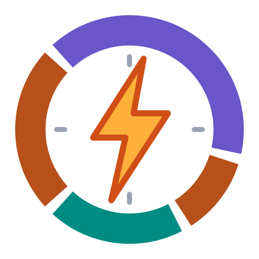

<p align="center">
  
</p>

# Taryfy prądu

[](https://github.com/keysim86/ha-taryfy-pradu/releases/latest)
[](https://github.com/keysim86/ha-taryfy-pradu)
[](https://www.home-assistant.io/)
[](LICENSE)

Integracja Home Assistant do śledzenia **bieżących kosztów energii elektrycznej według taryfy strefowej**:
która strefa obowiązuje teraz, ile kosztuje kWh, kiedy zmiana, ile kosztował dzisiejszy dzień,
miesiąc i rok — z uwzględnieniem sezonów, dni roboczych, weekendów i świąt.

- **Wbudowane wzorce (TAURON Dystrybucja, taryfa na 2026 r.):** **G11**, **G12**, **G12w**, **G12as**, **G13**, **G13s**
  i **G14dynamic** — z godzinami stref i stawkami dystrybucji. G14dynamic pobiera strefy na bieżąco z PSE.
- **Kreator taryf w panelu HA:** własne strefy, sezony, godziny dla dni roboczych i wolnych, czas lokalny albo zimowy.
- **Cennik ze składników faktury:** energia od sprzedawcy, dystrybucja zmienna i stała, opłaty jakościowa, OZE,
  kogeneracyjna, mocowa, abonamentowa, handlowa, VAT. Każdy składnik zmienny może zależeć od sezonu, rodzaju dnia i strefy.
- **Zmiany z wyprzedzeniem:** nowy cennik **i/lub nowa taryfa** od wybranego dnia — wpisujesz wcześniej, integracja
  przełączy się sama o północy, a wcześniejsze koszty zostają policzone po starych cenach.
- **Porównanie taryf:** Twoje rzeczywiste zużycie godzinowe z ostatnich 30 dni i 12 miesięcy przeliczone według
  wariantów (taryfa + cennik oferty) — najtańsza taryfa, możliwa oszczędność i rekomendacja zmiany.
- **Do automatyzacji:** sensory strefy i ceny, czujniki „najtańsza / najdroższa strefa teraz”, kalendarz stref,
  zdarzenie zmiany strefy i usługa „najtańszy przedział” (kiedy włączyć pralkę).

## Instalacja

Marketplace (HACS) → ⋮ → **Niestandardowe repozytoria** → `https://github.com/keysim86/ha-taryfy-pradu`, typ **Integracja**
→ zainstaluj **Taryfy prądu** → uruchom ponownie Home Assistanta → **Ustawienia → Urządzenia i usługi → Dodaj integrację →
Taryfy prądu**.

## Konfiguracja

1. **Dodaj taryfę** (w integracji: ⋮ / „Dodaj taryfę”). Wybierz wzorzec (G13s, G13) albo pustą taryfę. Kreator prowadzi przez:
   - **podstawy** — nazwa, operator, czas stref, rodzaje dni, lista stref, sezony (`Lato: 04-01 .. 09-30`);
   - **godziny stref** dla każdego sezonu i rodzaju dnia — np. `07:00-09:00, 17:00-21:00` albo `21-7`
     (przez północ). Kreator sprawdza, czy strefy pokrywają dobę dokładnie raz.
2. **Dodaj punkt poboru** — licznik energii (sensor kWh, narastający) i taryfa. Potem cennik:
   - **od czego zależą stawki** każdego składnika zmiennego (sezon / rodzaj dnia / strefa);
   - **stawki netto** z faktury — dystrybucja i opłaty są podpowiedziane z taryfy operatora, energię od sprzedawcy wpisujesz sam.
3. Później: **Cennik i ustawienia** punktu:
   - **zmień obowiązujący cennik** (np. po nowej fakturze),
   - **zaplanuj nowy cennik lub taryfę od wybranego dnia** — data, taryfa, stawki,
   - **usuń cennik** z harmonogramu,
   - **dodaj / usuń wariant do porównania** — taryfa i cennik oferty, z którą porównać obecne rozliczenie,
   - **nazwa i licznik**.

   Taryfę edytujesz tym samym kreatorem, którym ją dodałeś.

### Uwagi do taryf

- **G12as** — nocna stawka dystrybucji 0,0246 zł/kWh dotyczy tylko zużycia *ponad* zużycie z analogicznego okresu
  poprzedniego roku; do tego poziomu obowiązuje 0,2464 zł/kWh. Integracja tego progu nie liczy (wzorzec: 0,2464).
- **G14dynamic** — strefy S1 „zalecane użytkowanie” … S4 „wymagane ograniczenie” pochodzą z Energetycznego Kompasu PSE
  (`api.raporty.pse.pl`, raport `pdgsz`), pobierane co 30 minut na dziś i jutro (plan na jutro PSE publikuje ok. 16:00).
  Dla godzin bez danych obowiązuje S2. Kreator nie pyta o godziny.

### Dni wolne

Dzień wolny = sobota, niedziela i dni ustawowo wolne od pracy: Nowy Rok, Trzech Króli, Wielkanoc i Poniedziałek
Wielkanocny, 1 i 3 maja, Zesłanie Ducha Świętego, Boże Ciało, 15 sierpnia, 1 i 11 listopada, **Wigilia (od 2025)**,
25 i 26 grudnia. Święta ruchome liczone są z daty Wielkanocy.

### Czas stref

Taryfy OSD opisują zegary liczników ustawiane **wg czasu zimowego, bez zmiany latem** — chyba że licznik sam
utrzymuje godziny stref. Dlatego taryfa ma wybór:

- **lokalny** — strefy wg zegara w Polsce (latem UTC+2),
- **zimowy** — strefy wg UTC+1 przez cały rok (latem przesunięte o godzinę w stosunku do zegara).

Jeśli nie wiesz, który obowiązuje u Ciebie, porównaj latem dane godzinowe z licznika (np. eLicznik / portal OSD)
z planem stref.

## Encje punktu poboru

| Encja | Opis |
|---|---|
| `sensor.<punkt>_strefa` | bieżąca strefa; atrybuty: sezon, rodzaj dnia, od–do, plan i ceny na dziś i jutro |
| `sensor.<punkt>_cena` | cena brutto zł/kWh teraz (z rozbiciem na składniki) — nadaje się jako cena w panelu **Energia** |
| `sensor.<punkt>_nastepna_strefa`, `_zmiana_strefy`, `_cena_w_nastepnej_strefie` | co i kiedy będzie dalej |
| `sensor.<punkt>_koszt_dzis`, `_koszt_w_tym_miesiacu`, `_koszt_w_tym_roku` | koszt brutto: energia + proporcjonalna część opłat stałych |
| `sensor.<punkt>_koszt_energii_narastajaco` | narastający koszt samej energii — jako „koszt” w panelu Energia |
| `sensor.<punkt>_energia_<strefa>`, `_energia_dzis_<strefa>` | zużycie w strefie (narastająco i dziś) |
| `sensor.<punkt>_cena_dzis_<strefa>` | dzisiejsza cena strefy (diagnostyczne) |
| `binary_sensor.<punkt>_najtansza_strefa_teraz`, `_najdrozsza_strefa_teraz` | czy teraz jest najtaniej / najdrożej w tej dobie |
| `binary_sensor.<punkt>_dzien_wolny_wg_taryfy` | dzień wolny (atrybut `swieto`) |
| `calendar.<punkt>_strefy` | strefy jako wydarzenia (z ceną) — wyzwalacze kalendarza w automatyzacjach |
| `sensor.<punkt>_najtansza_taryfa_30_dni` | wynik porównania; atrybuty: ranking kosztów (30 dni i rok), rekomendacja |
| `sensor.<punkt>_mozliwa_oszczednosc_30_dni` | ile byłoby taniej w najtańszym wariancie |
| `binary_sensor.<punkt>_oplaca_sie_zmiana_taryfy` | wariant tańszy o co najmniej 3% i 5 zł w ostatnich 30 dniach |

Porównanie **nie liczy opłaty handlowej** (jest indywidualna dla oferty sprzedawcy, a nie dla taryfy).
Korzysta ze statystyk długoterminowych licznika w Home Assistancie (godzina po godzinie) i liczy się raz
na dobę o 3:30 (oraz po starcie); na żądanie — usługa `taryfy_pradu.porownaj_taryfy`. Warianty dynamiczne (G14)
porównywane są tylko na ostatnich 30 dniach (tyle historii stref pobiera integracja).

Koszt energii liczony jest z przyrostów licznika po cenie strefy z chwili zużycia. Przyrosty z czasu, gdy Home
Assistant nie działał, nie są doliczane (nie wiadomo, w której strefie zostały zużyte).

## Automatyzacje

Zdarzenie `taryfy_pradu_zmiana_strefy` (dane: `punkt`, `strefa`, `nazwa_strefy`, `poprzednia`, `cena`):

```yaml
triggers:
  - trigger: event
    event_type: taryfy_pradu_zmiana_strefy
    event_data:
      strefa: nocna
actions:
  - action: switch.turn_on
    target:
      entity_id: switch.bojler
```

Najtańszy przedział dla urządzenia pracującego 2 godziny:

```yaml
actions:
  - action: taryfy_pradu.najtanszy_przedzial
    data:
      encja: sensor.dom_cena
      czas_trwania: "02:00:00"
    response_variable: przedzial
  - action: notify.mobile_app_telefon
    data:
      message: "Pralka najtaniej od {{ as_timestamp(przedzial.start) | timestamp_custom('%H:%M') }}
                (średnio {{ przedzial.srednia_cena }} zł/kWh)"
```

Usługa `taryfy_pradu.cena` zwraca strefę i cenę w podanej chwili (`chwila`, domyślnie teraz).

## Źródła

Godziny stref i stawki wzorców: *Taryfa TAURON Dystrybucja S.A. na rok 2026* (decyzja Prezesa URE
DRE.WRE.4211.54.8.2025.ASa1 z 17.12.2025), wyciąg dla grup taryfowych G. Stawki zmieniają się co rok —
sprawdzaj je z fakturą.

## Licencja

MIT
